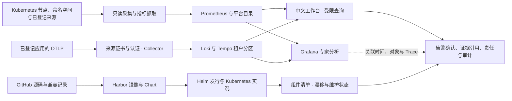

# 公共观测平台端到端方案

本方案评审 独立本地卷验证档的真实链路，沿用 V3 的数据语义、受控查询、开源组件升级和中文产品合同。现有工作台继续承担值班入口。Grafana 用于专家分析，Harbor 与 Helm 管理发行，组件运行清单把这三条路径连接起来。

## 1. 组件、角色与使用入口

| 使用者和任务 | 首选入口 | 截至本轮核查的状态 |
| --- | --- | --- |
| 租户值班，确认服务症状、数据缺口、事件原件与处理责任 | 中文工作台的运行概览、指标与链路、事件证据、告警处理 | 真实租户 A/B 与浏览器验收通过。按当前角色和登记来源查询 |
| 平台值班，检查节点、命名空间、抓取和可观测平台自身故障 | 中文工作台的「平台健康与诊断」，结合组件运行清单 | 节点、命名空间和来源质量在工作台。组件清单由运维客户端只读生成 |
| 平台工程师，执行跨时间窗、跨信号和高粒度排障 | Grafana Dashboards / Explore，按权限使用 PromQL、LogQL、TraceQL | 验证集群内网 Grafana 已部署，登录页和健康端点实测可达。专家 SSO、权限和关联跳转需单独验收 |
| 平台工程师，核对 Prometheus 采集、标签、规则和告警路由 | Prometheus 查询页、Targets、Rules 与 Alertmanager | 验证集群内网查询页、Targets API 与 Alertmanager 页面实测可达 |
| 采集负责人，确定入口拒绝、队列饱和或出口故障 | Collector 内部指标、探针和受控日志，优先汇入 Grafana | 四个采集 release 的内部指标实测可读。zPages 如需使用，单独配置仅管理员可达的临时诊断入口 |
| 后端负责人，确认日志与 Trace 数据能否读取 | Loki / Tempo 的就绪、构建版本和查询 API；数据分析用 Grafana | 验证集群的就绪和构建版本实测可读。管理 API 保持内网受控 |
| 发行维护者，查看待升级项、制品、变更与回退 | Git 发行记录、Harbor 制品、Helm 修订、Kubernetes 运行清单、演练回执 | 已有独立 release、镜像和 OCI Chart。统一变更台账和自动候选比较按第 4 节实施 |
| 网络值班，排查连接拒绝、DNS 重试或跨节点链路 | 现有节点和 DNS 指标。需要流级证据时评估 Hubble | 验证集群的 Cilium 配置显示 Hubble 关闭。现阶段没有服务流地图资格 |

Grafana 的专家入口要经过独立授权。当前公共业务租户由平台服务端校验身份、来源与分区。Grafana OSS 的文件夹权限不能充当数据源查询隔离。共享 Grafana 中已配置的 Prometheus 数据源对授权工程师可见，因此租户加入 Grafana 之前，需选定租户独立实例或另行验证具备强制查询隔离的设计。Loki 与 Tempo 的租户请求头由受信任服务端固定，不能由浏览器、链接或日志属性决定。参见 [Grafana 数据源权限](https://grafana.com/docs/grafana/latest/administration/data-source-management/) 和 [Tempo 数据源与关联](https://grafana.com/docs/grafana/latest/datasources/tempo/)。

## 2. 从采集到处置的端到端路径



值班页面用三个问题组织数据。

1. **发生了什么**。显示受影响的服务或节点、依据和观测时刻。每张图给出时间窗、单位、覆盖范围和样本缺口。区分「没有请求」「未获得指标」「读后端失败」「来源未启用」。
2. **影响在哪里**。先展示节点、命名空间或租户对象，再钻取同一窗口内的指标、日志和 Trace。第一期保留已有的日志到 Trace 跳转。长窗口、原始查询和多面板比对交给 Grafana。
3. **下一步谁处理**。告警注明责任方、支持编号、证据和核验手册。规则当前恢复、人员确认和业务原操作结果分别记录。平台故障时，用独立探针和内网原生入口判断平台是否失明。

一个完整故障旅程应从同一个时间窗穿过这些入口。例如平台日志缺失时，先核对 Collector 接收拒绝和出口失败，再检查 Loki 就绪与租户查询。若入口接受但原标识查不到，记录为查询可见性未证实，同时检查批处理、重试、保留和分区。仅用收发计数差值不能判断丢失。参见 [OpenTelemetry Collector 内部遥测](https://opentelemetry.io/docs/collector/internal-telemetry/)。

## 3. 专家诊断如何呈现

建议以 Grafana 下列三套版本化仪表板覆盖常见任务，使用实际部署版本的指标名验证查询。

| 仪表板 | 首屏应回答 | 核验数据 |
| --- | --- | --- |
| 集群与基础设施 | 哪个节点有 CPU、内存、磁盘压力，哪些命名空间调度异常 | node exporter、资源 API、CoreDNS、抓取目标与样本时间 |
| 可观测平台自身 | Collector 是否收得到和送得出，某个后端是否造成查询失败 | 各 Collector 接收/拒绝、队列/重试、Loki/Tempo 查询错误、Prometheus 抓取、平台请求成功率 |
| 服务排障 | 请求量、错误率、耗时的变化与哪条实际 Trace 对得上 | 已登记服务的指标、日志和链路，明确低流量与部分覆盖 |

未来中文工作台的专家入口只需传递经过校验的对象、起止时间、Trace ID 和受控仪表板 UID。原生页面的权限、时间范围和语言由独立浏览器验收覆盖。管理员临时查看内网组件原生页时，可使用经授权的运维终端，以 `kubectl -n ops-observability port-forward --address 127.0.0.1 svc/ops-grafana 13000:80` 建立本地会话。Prometheus 可使用 `svc/ops-prometheus 19090:80`，Alertmanager 可使用 `svc/ops-alertmanager 19093:9093`。目标端口以现场清单为准。组件健康页不承担租户查询授权。

完善 Alertmanager、Grafana 与平台告警时，每条规则登记唯一的评估主体与通知责任。Prometheus 负责公共阈值评估，平台负责归因、确认、原件和审计。专家仪表板可显示相同告警，但平行规则需要独立命名和通知分工，防止同一症状重复派单。

## 4. 开源组件统一管理

管理单位是 **组件发行 + 运行档位**。每个组件都要关联四类记录。

| 记录 | 权威来源 | 内容 |
| --- | --- | --- |
| 候选与已接受配置 | Git | Chart 版本、镜像摘要、覆盖值、支持矩阵、依赖顺序、恢复约束、评审人 |
| 制品 | Harbor OCI | 原 Chart、自产 Chart、平台及上游镜像、离线工具、SBOM。分别记录源摘要和目标摘要 |
| 实际运行 | 验证集群 Helm 与 Kubernetes | release 修订、Chart 的 appVersion、工作负载镜像声明、容器运行 imageID、就绪数、PVC 绑定与保留策略 |
| 数据与资格 | 现场证据 | 查询、隔离、负载、同版本复原、跨版本恢复、快照时间及缺口 |

`tools/component-inventory.py` 从已贴归属标签的命名空间生成组件 JSON 或 Markdown。它检查部署状态、摘要固定、就绪数量、PVC 绑定和生命周期，并可和同一命名空间的已审查基线比较。它不读取应用 Secret 内容，不写集群。Helm CLI 本身仍需已有发行存储的读取权限，建议从现有运维终端执行。JSON 中的运行镜像原样记录。若运行时只返回 image config ID，不能直接与 OCI manifest 摘要判等。

```sh
python3 tools/component-inventory.py --format markdown
python3 tools/component-inventory.py --format json > components.observed.json
python3 tools/component-inventory.py --baseline components.accepted.json
```

退出码 0 表示观察范围内未发现声明异常。1 表示清单已生成且发现异常或漂移。2 表示无法完成读取。初始基线先对照 Harbor 发行锁与现场责任范围审查，再保存为 accepted 文件。运行清单反映观测时刻，不能从一次快照推断写入完整性或组件实际查询结果。

升级由现有 Helm 操作者执行。当前 release 继续独立发布，统一用同一候选记录和验收流程管理。采用统一发行清单可以保留 Prometheus/Loki/Tempo/Grafana 等独立版本域，同时约束组合兼容性和维护顺序。若后续需要持续对账，再评估 GitOps 控制器并定义统一写入权，避免现有手工 Helm 与控制器并行调整同一个 release。

| 步骤 | 可检查结果 |
| --- | --- |
| 登记变更 | 旧版与目标版、上游维护公告、配置/协议/数据格式差异、影响范围、责任人 |
| 构建候选 | 经受控出口显式代理下载，目标架构校验，Harbor 回读 OCI 摘要。固定 Chart、容器、插件、工具和数据库格式 |
| 渲染与审查 | 用现场覆盖值和已锁版本渲染，核查全部镜像、权限、网络、PVC 保留、服务地址与升级顺序 |
| 隔离验证 | 使用实际历史数据的受控副本验证采集、日志、Trace、权限和原记录回读。一次只切换受影响的相邻版本域 |
| 备份与提升 | 确认备份异机副本、旧版可读窗口、停写时刻和回退条件。生产操作记录 release 旧修订与准确目标制品 |
| 联合验收 | 以历史查询、双租户隔离、规则和浏览器实测结合运行清单关闭变更。由发行负责人接受或恢复 |

Prometheus 重点核对抓取任务、规则和 TSDB。Collector 重点核对实际模块、名字变更、TLS 与信号样本。Loki 重点核对原生分区、索引与 WAL。Tempo 要核对实际镜像版本、部署模式、WAL/块格式和历史 Trace。Grafana 需核对 SQLite 或外部数据库、数据源、插件、仪表板及身份。Dex 要结合签名密钥、角色映射和真实登录。回退只在旧版本支持当前存储格式时使用 Helm 修订。存在迁移时用验证过的恢复或切流方案。

验证集群的 Loki 曾在停写备份中触发上游默认的缩容删 PVC 行为。原底层 PV 采用 Retain，重新绑定后已查询到备份前独立保存的历史标识。当前 Chart 覆盖值和实际 StatefulSet 均显式使用 Retain / Retain。后续任何停写演练都需先核对保留策略和绑定身份，保留事件记录并实际查回历史。

## 5. eBPF 的价值、试点和退出

Hubble 优先评估已有 Cilium 的流观察，适用于定位拒绝、DNS、连接路径和依赖关系。其用户界面依赖 Cilium 的 Hubble 能力与 Relay，单装界面无法提供当前集群流数据。启用可能改动共享网络组件，应在独立测试环境或经集群负责人协调的维护窗口完成。参见 [Cilium Hubble UI](https://docs.cilium.io/en/stable/observability/hubble/hubble-ui/)。

需要在未插桩应用补充请求证据时，另评估 OpenTelemetry eBPF Instrumentation。试点先确认内核、运行时、所需权限、可见协议和租户投影。选择一组明确允许的观测工作负载，对比已有 OpenTelemetry 数据，核对重复计数、加密路径、丢弃率、节点资源开销和撤除后的行为。持续剖析单独明确 CPU、阻塞或内存定位问题、数据保留和可访问范围。工具是否进入发行档由可复现实测决定。

## 6. 下一阶段交付顺序

1. 以 验证集群的即时清单、原生端点探测和 Harbor 锁形成首份组件基线。先核实声明、实际镜像和数据状态。
2. 由平台运维验收 Grafana 工程师认证、版控仪表板、Trace 与日志关联和独立权限。工作台保留值班旅程，专家入口通过后再纳入导航。
3. 用一个明确的上游补丁候选走完渲染、历史数据副本、升级与回退流程，再评估是否需要引入自动对账控制器。
4. 有具体网络故障案例时执行 Hubble 试点，以流证据、额外开销和撤除效果完成判断。相关集群变更另行协调。

补充阅读 [多租户与平台级观测设计](多租户与平台级观测设计.md)、[制品分发与升级管理](制品分发与升级管理.md)、[运维与恢复](运维与恢复.md)。
