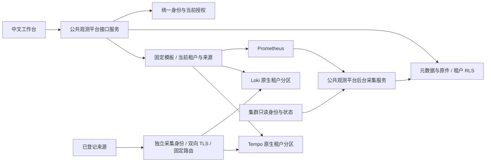

# 多租户与平台级观测设计

## 1. 两类责任与数据域

公共观测平台有两个平行视角。平台值班人员观察集群节点、基础设施、命名空间健康与采集链路；租户人员观察自己已登记服务的指标、日志、链路、事件原件与告警。平台角色不因权限名称包含“平台”就继承全部租户业务数据。主机和 Kubernetes 管理员属于基础设施的受信任管理边界，不能与平台页面角色混为一谈。

| 角色 | 数据范围 | 允许行为 |
|---|---|---|
| 平台管理员／只读人员 | 平台域基础设施与本平台自身数据 | 读取平台视图；管理员可以确认本域告警 |
| 租户管理员 | 当前绑定租户及登记来源 | 读取证据，接收本站通知，确认处理责任，按权限提交普通观察 |
| 租户只读人员 | 当前绑定租户及登记来源 | 查询和下载；服务端拒绝写操作 |
| 来源采集身份 | 明确登记的租户、来源和能力 | 提交来源观察，不能交互登录或读取其他证据 |

测试租户 A/B 中的同名参考服务用于验证隔离，不代表实际业务系统已接入。Neon 的领域接口、执行账本、部署和运行资格全部暂停。

## 2. 隔离贯穿数据路径

第一层是当前授权。浏览器不会决定 tenant、角色或存储分区；后端按每次请求重新读取当前绑定。OIDC 使用签名、issuer、audience、有效期、nonce、PKCE 与单次 state；登录中间状态和不透明会话保存在 PostgreSQL，支持多个接口副本。会话只保存摘要索引，应急登录同样不把个人凭据放入 Cookie。注销要真正删除服务端会话，失败不能返回已完成。

配置由 Kubernetes 投影到各副本，所以撤权存在传播时间。验收逐个副本检查收敛，档位上限为 125 秒，不能表述为全局瞬时撤权。重新启用同一凭据与撤销失窃凭据是不同操作；失窃应轮换并撤销相关会话。

第二层是存储和查询。PostgreSQL 使用非超级、非 BYPASSRLS 身份，租户表启用并强制 RLS；每个事务设置当前租户。Loki 和 Tempo 启用原生租户分区，接口服务从注册表注入分区 Header。Prometheus 使用受信任抓取配置固定 `job` 与 `ops_tenant`，关闭业务自报标签的覆盖权；租户只能通过固定模板代理查询。Prometheus 管理接口和 Grafana 管理入口不对租户直接开放。

第三层是采集身份。当前档位为登记来源配置独立客户端证书、服务端证书与签发域，并叠加入口认证。Collector 出口的租户分区和来源由配置固定，忽略生产者自报 Header 和 resource 属性。不同租户使用相同 service.name 时仍进入不同物理分区。接入更多来源需要显式登记、签发和锁定能力，不能依赖 service.name 本身作为安全身份。

第四层是网络与资源。租户命名空间启用受限 Pod 安全、资源配额与网络策略，只允许必要 DNS、自己的采集入口与经过认证的公共平台接口。验证同时设置正向对照，避免把 DNS 或服务本来不可用误当成隔离成功。平台后台采集只有 Kubernetes 读取权限，没有 Secret 资源读取、exec 或写操作权限。

接口当前采用每副本全局 32、每租户 4 的并发预算，后端有固定超时、响应大小与结果数量限制。两个接口副本的预算不能宣传成跨副本共享的全局租户限额。扩大租户与来源数量须按新负载档位重新验证。

## 3. 平台数据如何保持可信

| 维度 | 当前采集与检测 | 解释边界 |
|---|---|---|
| 节点 | 原始 UID、Ready/压力条件、容量、可分配资源、CPU/内存用量、磁盘和网络指标 | 节点就绪不证明业务请求成功；用量保留自己的样本时刻 |
| 命名空间 | 就绪、Pending、异常启动、历史失败、完成任务、PVC 绑定、控制器失败与配额 | 当前异常与历史失败分别显示；同名重建保留 UID |
| 采集质量 | 固定预期目标、实际观察集合、最近尝试/成功、身份变化、不可用和过期 | 失联目标不从分母消失；空结果不能自动变成正常零值 |
| 服务体验 | 已登记服务的可达、请求、失败比例、耗时估算、日志和 Trace | 低样本或缺失字段显示未提供，不能补成功数据 |
| 平台事务 | 原始字节、摘要、dedup、冲突、附件、审计与 outbox | 只证明平台收到并保存的内容；不创造来源业务执行权威 |

集群和命名空间登记使用原始 UID。来源身份变化时停止接受新快照，把旧观察标为待确认；同名新资源不能继承旧身份。节点预期集合由登记决定，观察不到的节点仍保留在分母。当前快照采用 90 秒平台新鲜度窗口；历史观察与当前状态分开保留。

目录采集只解码需要的 Kubernetes 身份和状态字段，不持久化工作负载环境变量、Secret 值或自由文本错误内容。Pod 读取权限本身没有字段级限制，因此采集进程必须属于受信任的平台边界。文件日志只读取明确的基础设施路径白名单，应用日志通过登记入口提供；不因安装了日志组件就宣布收集了所有业务信息。

## 4. 从信息展示走到处理闭环

人员先确定租户、来源、时间和当前症状，再核对可用样本、采集质量与服务体验。日志可跳转到当前租户内的 Trace；目录保留 UID、状态和历史。告警规则只表示需要核验的症状，确认处理责任会生成事务审计；规则恢复另外记录，不能覆盖原请求结果。中文摘要导出包含实际授权范围内的事件引用和 SHA256，可以回到原件验证。

平台保留四个独立结论：原请求结果、资源效果、服务体验和证据覆盖。普通遥测与轮询快照只能提供部分证据，不能推断原业务操作成功。恢复、重放和来源重启也不能把证据缺口改写成完整历史。

## 5. 高级诊断的使用条件

eBPF、Hubble 流量、内核事件和持续剖析不是安装清单上的装饰。启用前要明确需要回答的问题，例如丢包位置、TCP 重传、调度阻塞或 CPU 热点；再限定来源、命名空间、采样、持续时间、资源预算、权限、隐私字段与回退步骤，最后用真实问题验证收益。当前未启用的项目保持 NOT_RUN，不修改共享 CNI 或其他团队的运行环境。

当前持久化后端为单实例本地卷档位。两个接口副本提高接口更新期间的冗余，不等于数据库、日志和链路存储具备跨节点自动高可用。独立恢复、原件完整性和故障退化分别验收，最终支持范围以发行清单为准。
